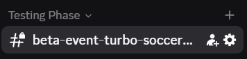

<div align="center">

# 🎮 TESTER TRAINING GUIDE

### ⚡ OFFICIAL TESTING DOCUMENTATION ⚡

**CLAIM → SET UP → TEST → REPORT → APPROVE**

Welcome to the testing team!

As a tester, your responsibility is to make sure every script works correctly before it gets approved.

This guide explains everything you need to know about the testing process.

**Read everything carefully before starting your first test.**

---

</div>

## 💬 01 — DISCORD CHANNELS

Our Discord server has **three main communication channels**.

| Channel             | Description                                                             |
| :------------------ | :---------------------------------------------------------------------- |
| 🛡️ **Staff Chat**  | Reserved for staff discussions, management, and coordination.           |
| 🧪 **Tester Chat**  | Dedicated to testing discussions, bug reports, questions, and feedback. |
| 💬 **General Chat** | For regular community conversations.                                    |

> [!CAUTION]
>
> ### 🚫 STRICT CONFIDENTIALITY RULE
>
> **NEVER discuss ongoing tests, unreleased scripts, or testing information in the General Chat without permission from both the developer and staff.**
>
> All testing-related conversations must remain in the appropriate channels.
>
> Breaking this rule may result in disciplinary action.

---

## 🔎 02 — FINDING A TEST

Whenever a new script becomes available for testing, a dedicated channel will appear under the **Testing Phase** category.

### 📸 Example



### What should you do?

**STEP 1** — Open the new testing channel.

**STEP 2** — Scroll all the way to the **TOP** of the channel.

**STEP 3** — Find the interactive testing panel.

**STEP 4** — Click the button:

### 🎮 `Claim This Game`

This allows you to claim the game for testing.

**STEP 5** — Once claimed, click:

### 📋 `View Script and Features`

This will display the script information and the list of features that must be tested.

> [!IMPORTANT]
> You must check **EVERY FEATURE** listed in the panel. Skipping features is not acceptable.

---

## 🔑 03 — GETTING YOUR SCRIPT KEY

Before running the script, you need to retrieve your personal testing key.

### Follow these steps:

1. Open the testing panel.
2. Find the **`Reveal Key`** button.
3. Click it to reveal your key.
4. Copy the key.
5. Replace the placeholder in the script.

### 💻 SCRIPT LOADER

```lua
script_key = "PASTE-YOUR-KEY-HERE"

loadstring(game:HttpGet("https://vampauth.com/v1/loaders/dca21ccb2e5457bed571ba9fee943e7a.lua"))()
```

### ⚙️ How to configure it

Find this line:

```lua
script_key = "PASTE-YOUR-KEY-HERE"
```

Replace `PASTE-YOUR-KEY-HERE` with the key you obtained from **Reveal Key**.

### Example

```lua
script_key = "YOUR-ACTUAL-KEY"
```

Once your key has been inserted, you can run the script in your authorized testing environment.

> [!WARNING]
>
> ### 🔒 KEY SECURITY
>
> * Never share your personal key.
> * Never post your key in public channels.
> * Never give your key to another tester.
> * Only execute scripts in authorized testing environments.

---

## 🧪 04 — TESTING THE FEATURES

Once the script is running, your job officially begins.

You must carefully test **EVERY SINGLE FEATURE** displayed under:

### 📋 `View Script and Features`

Don't just check whether the script launches.

You need to verify that everything actually works.

### ✅ Testing Checklist

* [ ] The script loads correctly.
* [ ] The interface opens without issues.
* [ ] Every listed feature has been tested.
* [ ] All buttons and interactions work.
* [ ] Features behave as expected.
* [ ] No errors or unexpected behavior occur.
* [ ] No crashes or freezes happen during testing.
* [ ] Potential improvements have been considered.

> [!TIP]
>
> ### 💡 THINK LIKE A TESTER
>
> Don't simply use the features once.
>
> Try different situations and interactions to identify problems that might not be immediately obvious.

---

## 🐛 05 — REPORTING BUGS

Found something broken?

**DO NOT IGNORE IT.**

If a feature doesn't work properly, you must immediately inform the developer responsible for that script.

### 📢 How to report a problem

**STEP 1** — Go to the appropriate testing chat.

**STEP 2** — Ping the developer responsible for the script.

**STEP 3** — Explain the issue clearly.

**STEP 4** — Describe what should happen instead.

**STEP 5** — Provide screenshots or videos if possible.

### 📝 Bug Report Template

```text
🐛 BUG REPORT

🎮 Game:
[Game Name]

⚙️ Feature:
[Feature Name]

❌ Problem:
[Explain what doesn't work]

✅ Expected Behavior:
[Explain what should happen]

🔁 Steps to Reproduce:
1.
2.
3.

📸 Evidence:
[Screenshot / Video if available]

👨‍💻 Developer:
@Developer
```

> [!IMPORTANT]
> Reporting a bug is not enough.
>
> Once the developer fixes the problem, you must test the feature again to confirm that it works correctly.

---

## 💡 06 — SUGGESTING NEW FEATURES

Testing isn't only about finding bugs.

You can also help improve scripts by suggesting useful features.

If you believe something important is missing, you should contact the developer responsible for the script.

### 🚀 Feature Suggestion Template

```text
💡 FEATURE SUGGESTION

🎮 Game:
[Game Name]

✨ Suggested Feature:
[Feature Name]

📝 Description:
[Explain your idea]

🎯 Why It Should Be Added:
[Explain how this improves the script]

👨‍💻 Developer:
@Developer
```

### Remember

A good suggestion should be:

* ✅ Useful
* ✅ Relevant to the script
* ✅ Clearly explained
* ✅ Realistic to implement

The developer will decide whether the suggested feature should be added.

---

## 🟢 07 — APPROVING A SCRIPT

Once you have finished testing everything, you can proceed to the final step.

### ⚠️ BEFORE APPROVING

Make sure:

* [ ] Every feature has been tested.
* [ ] All reported bugs have been fixed.
* [ ] Fixed features have been tested again.
* [ ] The script works correctly.
* [ ] No known blocking issues remain.

### ✅ FINAL APPROVAL PROCEDURE

**STEP 1** — Return to the testing channel.

**STEP 2** — Scroll back to the testing panel at the top.

**STEP 3** — Find the approval button.

**STEP 4** — Click:

### ✅ `Approve`

**Congratulations! 🎉**

You have successfully completed the testing process.

> [!CAUTION]
>
> ### ⛔ NEVER APPROVE A BROKEN SCRIPT
>
> Clicking **Approve** means that you have tested the script and confirmed that everything works correctly.
>
> If something is still broken, report it to the developer instead of approving.

---

## 📜 08 — TESTER RULES

Every tester must follow these rules.

|  #  | Rule                                                                           |
| :-: | ------------------------------------------------------------------------------ |
|  01 | 🔒 Never discuss tests in General Chat without developer and staff permission. |
|  02 | 🎮 Always claim a game before testing it.                                      |
|  03 | 📋 Always read the full feature list.                                          |
|  04 | 🧪 Test every available feature.                                               |
|  05 | 🐛 Report bugs to the responsible developer.                                   |
|  06 | 💡 Suggest useful improvements when appropriate.                               |
|  07 | 🔁 Retest features after bugs are fixed.                                       |
|  08 | 🔑 Never share your testing key.                                               |
|  09 | ⛔ Never approve a script that still has unresolved issues.                     |
|  10 | ✅ Only click Approve once everything works correctly.                          |

---

## 🚀 09 — QUICK START

Forgot the process?

Here's everything you need to remember:

```text
          🎮 NEW TEST AVAILABLE
                    │
                    ▼
          📂 OPEN TEST CHANNEL
                    │
                    ▼
          ⬆️ SCROLL TO THE TOP
                    │
                    ▼
          🎮 CLAIM THIS GAME
                    │
                    ▼
       📋 VIEW SCRIPT AND FEATURES
                    │
                    ▼
              🔑 REVEAL KEY
                    │
                    ▼
          💻 INSERT KEY & RUN
                    │
                    ▼
          🧪 TEST ALL FEATURES
                    │
                    ▼
             ❓ ANY ISSUES?
                /       \
              YES        NO
               │          │
               ▼          │
       🐛 REPORT TO DEV    │
               │          │
               ▼          │
          🔧 BUG FIXED     │
               │          │
               ▼          │
          🔁 RETEST        │
               │          │
               └────┬─────┘
                    │
                    ▼
               ✅ APPROVE
                    │
                    ▼
          🎉 TEST COMPLETED
```

---

<div align="center">

# 🏆 QUALITY COMES FIRST

### CLAIM IT. TEST IT. REPORT IT. APPROVE IT.

**A good tester doesn't just find bugs.**

**A good tester helps make every release better.**

---

🧪 **TESTING TEAM**

*Official Tester Training Documentation*

**THANK YOU FOR HELPING US DELIVER BETTER SCRIPTS!** 🚀

</div>
